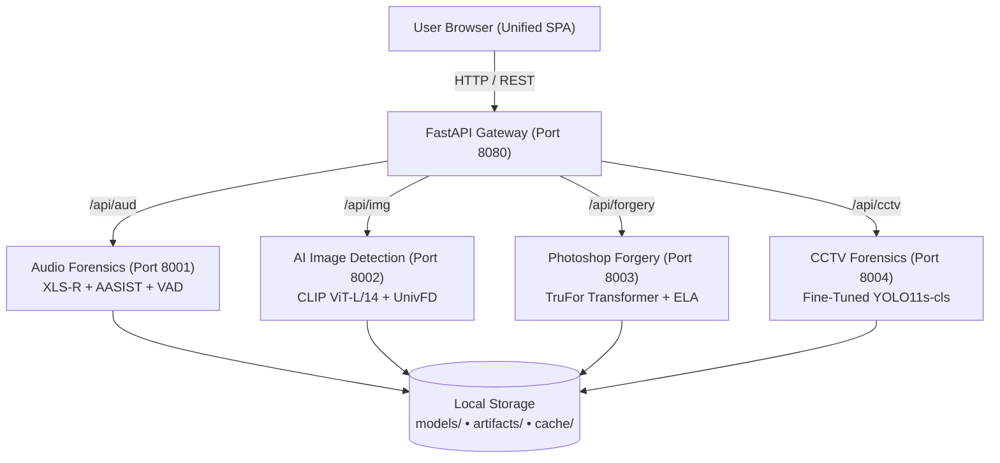

# PS-05: Digital Evidence Authenticity & Integrity Verification Platform

> A fully local, explainable multi-modal digital evidence verification system engineered for law enforcement, forensic laboratories, and digital forensics investigation units.

---

## Table of Contents

- [Part 1: How to Run](#part-1-how-to-run)
  - [1. Prerequisites & System Requirements](#1-prerequisites--system-requirements)
  - [2. Obtaining the Project](#2-obtaining-the-project)
  - [3. First Run (Step-by-Step)](#3-first-run-step-by-step)
  - [4. Every Subsequent Run](#4-every-subsequent-run)
  - [5. Stopping the Platform & Running Multiple Copies](#5-stopping-the-platform--running-multiple-copies)
  - [6. Offline Operation](#6-offline-operation)
  - [7. Previewing Launcher Actions (/dryrun)](#7-previewing-launcher-actions-dryrun)
  - [8. Using the Application in 60 Seconds](#8-using-the-application-in-60-seconds)
  - [9. Troubleshooting Guide](#9-troubleshooting-guide)
  - [10. Resetting & Cleaning Generated Files](#10-resetting--cleaning-generated-files)
  - [11. Manual Execution Without Launcher](#11-manual-execution-without-launcher)
- [Part 2: About the Project](#part-2-about-the-project)
  - [1. Overview & Operational Principles](#1-overview--operational-principles)
  - [2. PS-05 Requirement Coverage](#2-ps-05-requirement-coverage)
  - [3. System Architecture](#3-system-architecture)
  - [4. Repository Folder Structure](#4-repository-folder-structure)
  - [5. Forensic Modules Deep Dive](#5-forensic-modules-deep-dive)
    - [5.1 Audio Authenticity & Deepfake Detection (ai_aud)](#51-audio-authenticity--deepfake-detection-ai_aud)
    - [5.2 AI Image Synthesis Detection (ai_img)](#52-ai-image-synthesis-detection-ai_img)
    - [5.3 Photoshop Forgery & Splice Localization (image_forgery)](#53-photoshop-forgery--splice-localization-image_forgery)
    - [5.4 CCTV Video Temporal & Tamper Forensics (ai_cctv)](#54-cctv-video-temporal--tamper-forensics-ai_cctv)
  - [6. Standard Result Format](#6-standard-result-format)
  - [7. Comprehensive API Reference](#7-comprehensive-api-reference)
  - [8. Dashboard, Case History & Forensic Reporting](#8-dashboard-case-history--forensic-reporting)
  - [9. Neural Models Manifest & Calibration Workflows](#9-neural-models-manifest--calibration-workflows)
  - [10. Runtime Configuration & Environment Variables](#10-runtime-configuration--environment-variables)
  - [11. Automated Test Suite & Validation](#11-automated-test-suite--validation)
  - [12. Evidentiary Limitations & Responsible Use](#12-evidentiary-limitations--responsible-use)
  - [13. Known Issues, FAQ, Technology Stack & Credits](#13-known-issues-faq-technology-stack--credits)

---

# Part 1: How to Run

### 1. Prerequisites & System Requirements

Before running the platform, verify your host environment meets the following specifications:

- **Operating System**: Windows 10 or Windows 11 (64-bit architecture verified). Batch and PowerShell 5.1+ execution supported. *(Linux and macOS supported only via manual uvicorn module execution; not automated via root batch scripts)*.
- **Python Version**: Python 3.10.x 64-bit (specifically tested and verified on Python 3.10.11). Python 3.11+ is incompatible with Fairseq C-extensions; Python < 3.10 is not supported.
- **Free Disk Space**: Minimum **8.0 GB free disk space** required (10.0 GB recommended):
  - Base repository, source code, frontend, and tests: ~18 MB
  - Neural model checkpoints (downloaded once on setup): ~5.89 GB (6,027 MB)
  - Consolidated Python virtual environment (`.venv`): ~1.47 GB (1,503 MB)
  - Working directory buffer for uploaded media and visual evidence artifacts: ~1.0 GB
- **Internet Connectivity**: Required **ONLY on the initial execution** to download pip dependencies from PyPI and pre-trained neural model checkpoints from public repositories (Meta AI, HuggingFace, OpenAI Azure, Ultralytics, GRIP Unina). Once setup finishes, internet is completely unnecessary.
- **RAM / Hardware Acceleration**:
  - **RAM**: Minimum 8 GB physical RAM; 16 GB recommended for multi-window acoustic graph processing and video decoding.
  - **GPU**: Completely optional. If an NVIDIA CUDA GPU is detected (`torch.cuda.is_available()`), models automatically accelerate inference. If no GPU is found, all models seamlessly execute on CPU.
- **Web Browser**: Any modern web browser (Google Chrome, Microsoft Edge, Mozilla Firefox, Brave). No browser plugins or extensions required.

---

### 2. Obtaining the Project

1. Extract the provided archive (or clone the repository) into a local directory with write permissions, for example:
   ```cmd
   C:\Users\<Username>\Downloads\bihar
   ```
2. Open a standard Windows Command Prompt (`cmd.exe`) or Windows PowerShell.
3. Change directory to the root of the project:
   ```cmd
   cd /d C:\Users\<Username>\Downloads\bihar
   ```

---

### 3. First Run (Step-by-Step)

1. **Execute the One-Click Launcher**:
   In your terminal, run:
   ```cmd
   run_platform.bat
   ```
   *(Alternatively in PowerShell: `.\run_platform.bat` or `.\scripts\launch.ps1`)*

2. **What the Launcher Performs Automatically**:
   - **Step 1: System Verification**: Confirms 64-bit Windows architecture and detects Python 3.10 installation (`python.exe` or `py -3.10`).
   - **Step 2: Model Manifest Verification**: Inspects `models\MODELS.json`. Missing neural weights (`xlsr2_300m.pt`, `LA_model.pth`, `ViT-L-14.pt`, `trufor.pth.tar`, `yolo11s-cls.pt`) are downloaded using `curl.exe` with automatic resume (`-C -`) and retries. Every file is validated against its SHA-256 hash.
   - **Step 3: Virtual Environment Provisioning**: Creates a unified root `.venv` and installs pinned dependencies from `requirements-lock.txt`.
   - **Step 4: Process Hygiene**: Executes `scripts\stop.ps1` to terminate any stale processes occupying forensic ports.
   - **Step 5: Dynamic Free Port Allocation**: Tests network sockets and allocates free ports (defaulting to Gateway: `8080`, Audio: `8001`, AI Image: `8002`, Forgery: `8003`, CCTV: `8004`). Writes `runtime\ports.json`.
   - **Step 6: Service Supervision**: Spawns the 4 forensic microservices and the reverse-proxy Gateway in the background.
   - **Step 7: Health Verification & Launch**: Polls `/api/health` until all 4 backends return HTTP 200, displays a status table, and opens the default browser to the platform URL.

3. **Console Output Sequence**:
   ```text
   ======================================================================
      PS-05 Unified AI Forensics Platform - One-Click Launcher
      Working Directory: C:\Users\galah\Downloads\bihar
   ======================================================================
   [20:46:44] [STEP] Checking Windows system architecture...
   [20:46:44] [INFO] 64-bit Windows architecture verified.
   [20:46:44] [STEP] Verifying Python 3.10 installation...
   [20:46:44] [INFO] Found Python 3.10: C:\Users\...\Python310\python.exe
   [20:46:44] [STEP] Verifying neural model checkpoints against manifest...
   [20:46:49] [MUTED]   [VERIFIED] XLS-R 300M Base Wav2Vec2 (3,632.42 MB) SHA-256 confirmed.
   [20:46:50] [MUTED]   [VERIFIED] W2V2-AASIST Anti-Spoofing Classifier (1,212.72 MB) SHA-256 confirmed.
   [20:46:52] [MUTED]   [VERIFIED] CLIP ViT-L/14 Feature Backbone (889.56 MB) SHA-256 confirmed.
   [20:46:52] [MUTED]   [VERIFIED] Universal Fake Detect Linear Probe Classifier (0.00 MB) SHA-256 confirmed.
   [20:46:52] [MUTED]   [VERIFIED] TruFor Tampering Localization Weights (268.46 MB) SHA-256 confirmed.
   [20:46:52] [MUTED]   [VERIFIED] Fine-Tuned CCTV AI Tamper Detector (10.51 MB) SHA-256 confirmed.
   [20:46:52] [MUTED]   [VERIFIED] YOLO11s Classification Base Weights (13.00 MB) SHA-256 confirmed.
   [20:46:52] [STEP] Verifying Python virtual environment...
   [20:46:55] [INFO] Virtual environment and dependencies verified.
   Stopping Unified Forensics Platform services...
   All forensic services stopped successfully.
   [20:46:57] [STEP] Assigning free network ports for gateway and modules...
   [20:46:59] [INFO] Allocated Ports: Gateway=8080, Audio=8001, Image=8002, Forgery=8003, CCTV=8004
   [20:46:59] [INFO] Starting ai_aud on 127.0.0.1:8001...
   [20:47:00] [INFO] Starting ai_img on 127.0.0.1:8002...
   [20:47:00] [INFO] Starting image_forgery on 127.0.0.1:8003...
   [20:47:00] [INFO] Starting ai_cctv on 127.0.0.1:8004...
   [20:47:00] [INFO] Starting gateway on 127.0.0.1:8080...

   Waiting for backend services to initialize...

   Service Status Table:
   SERVICE                PORT       PID        STATUS
   ----------------------------------------------------------------------
   Gateway Server         8080       22572      [READY]
   Audio                  8001       9920       [ONLINE]
   AI Image               8002       66228      [ONLINE]
   Photoshop Forgery      8003       62524      [ONLINE]
   CCTV Video             8004       34284      [ONLINE]
   ----------------------------------------------------------------------

   ======================================================================
      PLATFORM ACTIVE - OPEN IN BROWSER:
      http://localhost:8080
   ======================================================================
   ```

4. **Duration**: First run takes approximately **10 to 20 minutes** (dominated by downloading 5.89 GB of models and pip installation). Subsequent launches complete in **8 to 12 seconds**.
5. **Accessing the UI Manually**: If your browser does not open automatically, navigate directly to:
   ```text
   http://localhost:8080
   ```
   *(If port 8080 was occupied, check the port printed next to `Gateway Server` in the console table, e.g. `http://localhost:8081`)*.

---

### 4. Every Subsequent Run

Once dependencies and models are installed, start the platform anytime with:
```cmd
run_platform.bat
```
The launcher verifies that all SHA-256 hashes match on disk, skips network downloads, skips pip installation, binds available ports, and launches all 5 servers in **under 10 seconds**.

---

### 5. Stopping the Platform & Running Multiple Copies

- **To Stop All Services**:
  Run from the terminal or double-click:
  ```cmd
  stop_platform.bat
  ```
  *(Alternatively, run `stop.bat` or press `Ctrl+C` in the launcher console window)*. This kills all background uvicorn processes by PID and frees ports `8080`, `8001`, `8002`, `8003`, and `8004`.
- **Running Multiple Copies**:
  If you launch a second instance while the first is running, the launcher automatically detects the occupied ports and shifts:
  - Instance 1: Gateway on `8080`, Modules on `8001-8004`
  - Instance 2: Gateway on `8081`, Modules on `8005-8008`

---

### 6. Offline Operation

After completing the initial setup run:
- **Zero Internet Connectivity Needed**: You can disconnect Ethernet, disable Wi-Fi, or deploy to an air-gapped forensic lab environment.
- **Zero Remote Dependencies**: Web fonts, SVG icons, and JavaScript libraries are stored 100% locally in `frontend/assets` and `frontend/js`. No CDN calls are made.
- **Local Neural Inference**: Weights are evaluated locally via PyTorch. No telemetry or evidence is transmitted outside the local machine.

---

### 7. Previewing Launcher Actions (/dryrun)

To inspect what the launcher would do without downloading files, modifying the filesystem, or starting servers, execute:
```cmd
run_platform.bat /dryrun
```
*(Or in PowerShell: `powershell -ExecutionPolicy Bypass -File scripts\launch.ps1 -DryRun`)*

**Verified Real Output**:
```text
[21:08:22] [WARN] DRY RUN MODE ENABLED - Pre-flight verification only; no services will start.
[21:08:22] [STEP] Checking Windows system architecture...
[21:08:22] [INFO] 64-bit Windows architecture verified.
[21:08:22] [STEP] Verifying Python 3.10 installation...
[21:08:22] [INFO] Found Python 3.10: C:\Users\...\Python310\python.exe
[21:08:22] [STEP] Verifying neural model checkpoints against manifest...
[21:08:22] [INFO]   [DryRun] Would download XLS-R 300M Base Wav2Vec2 from https://dl.fbaipublicfiles.com/fairseq/wav2vec/xlsr2_300m.pt -> ai_aud/audio_forensics/models/xlsr2_300m.pt
...
[21:08:26] [INFO] Allocated Ports: Gateway=8080, Audio=8001, Image=8002, Forgery=8003, CCTV=8004
[21:08:26] [INFO] [DryRun] Pre-flight checks and configuration plan passed cleanly.
```

---

### 8. Using the Application in 60 Seconds

1. **Select a Target Forensic Domain**:
   Click a quickstart card in the main view or select a module chip from the bottom dock:
   - **Audio Authenticity**: Deepfake voice clone and splice verification (`.wav`, `.mp3`, `.flac`, `.ogg`, `.m4a`).
   - **AI Image Detection**: Synthetic generator detection (`.jpg`, `.png`, `.webp`, `.bmp`, `.tiff`).
   - **Photoshop Forgery**: Splicing, copy-move, and ELA localization (`.jpg`, `.png`, `.webp`).
   - **CCTV Video Forensics**: Surveillance tamper and temporal frame analysis (`.mp4`, `.avi`, `.mov`, `.mkv`).
   - **Auto-Detect**: Automatically routes your file based on MIME-type and file header.
2. **Submit Evidence File**:
   Click the paperclip button (or drag and drop your file into the input card) and click the **Arrow Button** (or press Enter).
3. **Interpret the Findings**:
   - **Authenticity Verdict Banner**: Displays `Authentic / Genuine` (Green), `Suspicious / Inconclusive` (Amber), `Likely Tampered` (Red), or `Inconclusive - Human Review Recommended` (Gray).
   - **Calibrated Confidence**: Confidence percentage reflecting distance to decision boundaries. If score is unavailable (e.g. flat silent audio), displays `Confidence: not available` with reason.
   - **Interactive Visualizers**:
     - *Audio*: Waveform canvas with 4.04s analyzed windows and spectrogram.
     - *AI Image*: Calibrated $P(\text{fake})$ gauge and 9-crop spatial variation grid.
     - *Forgery*: TruFor localization heatmap overlay with opacity slider and Error Level Analysis (ELA).
     - *CCTV*: Video playback synchronized with clickable frame anomaly timeline chips.
4. **Export Findings**:
   - Click **Copy JSON** to copy the full forensic dictionary to the clipboard.
   - Click **Download Report** to open a clean, printable HTML evidence summary ready for browser Print-to-PDF archiving.

---

### 9. Troubleshooting Guide

| Problem | Likely Cause | Verified Technical Fix |
|:---|:---|:---|
| **Python not found or wrong version** | Python 3.10 is not on PATH or Python 3.11/3.12 is default | Install Python 3.10.11 64-bit from [python.org](https://www.python.org/downloads/release/python-31011/). Check "Add python.exe to PATH" during installation. Launcher checks `py -3.10` and `winget install Python.Python.3.10`. |
| **Port already in use error** | A previous instance or another server is using port 8080/8001-8004 | Run `stop_platform.bat`. The launcher automatically scans ports via `Get-NetTCPConnection` and picks the next available integer (e.g. 8081). |
| **Model download failed / Hash mismatch** | Network timeout or corrupted CDN download | Rerun `run_platform.bat`. The launcher uses `curl.exe -C -` to resume downloads from the byte offset. If a hash mismatch occurs, it removes the partial file and retries up to 3 times. |
| **Interrupted installation** | Terminal was closed during `pip install` or model download | Run `run_platform.bat` again. `launch.ps1` checks for `.deps_installed` and verifies file sizes; it picks up exactly where it was interrupted without repeating completed steps. |
| **Pip dependency conflict** | Incompatible numpy or torch version in environment | Use the exact root virtual environment created by `requirements-lock.txt`. NumPy is pinned to `1.26.4` to avoid ABI breakage with Fairseq and C-extensions. |
| **Out of memory / Slow processing on CPU** | Large 4K image or >10-minute video running on CPU | Large video files are sampled down to 1 FPS for inference; audio is windowed into 4.04s segments. Close memory-heavy applications. GPU acceleration is automatically activated if NVIDIA drivers are present. |
| **Blank page or missing sidebar tab** | Browser cached stale JavaScript assets or gateway offline | Perform a hard refresh (`Ctrl + F5`). Ensure Gateway server is running and `http://127.0.0.1:8080/api/health` returns `"status": "healthy"`. |
| **Windows SmartScreen / Antivirus blocks script** | Windows Defender flags unsigned `.bat` or PowerShell execution | Right-click `run_platform.bat` -> Properties -> check "Unblock" -> Apply. Run Command Prompt as Administrator if execution policy restricted (`Set-ExecutionPolicy -Scope Process Bypass`). |
| **File too large (HTTP 413)** | Uploaded file exceeds configured module size limit | Limits: Video=2 GB (`2147483648` bytes), Audio=500 MB (`524288000` bytes), Images=100 MB (`104857600` bytes). Defined in `config\modules.json`. |
| **"Model not trained" banner in CCTV module** | Fine-tuned weights missing or zero frames detected | Ensure `ai_cctv\ai_cctv_detection\models\best.pt` (10.51 MB) is present in the repository. Verify video codec is decodable by PyAV/OpenCV. |

---

### 10. Resetting & Cleaning Generated Files

The platform maintains strict separation between source code, committed assets, and runtime artifacts.

- **Safe to Delete (Will Be Recreated Automatically)**:
  - Root virtual environment: `.venv/`
  - Uploaded temporary evidence files: `uploads/*`, `*/uploads/*` *(keep `.gitkeep`)*
  - Generated visual overlays and heatmaps: `artifacts/*`, `*/artifacts/*` *(keep `.gitkeep`)*
  - Forensic result caches: `cache/*`, `*/cache/*` *(keep `.gitkeep`)*
  - Diagnostic logs: `logs/*` *(keep `.gitkeep`)*
  - Dynamic port allocations: `runtime/ports.json`, `runtime/pids.json`
  - Python byte-cache: `__pycache__/`, `.pytest_cache/`
- **DO NOT Delete (Required for Operation)**:
  - Model manifest: `models/MODELS.json`
  - Gateway configuration: `config/modules.json`
  - Pinned dependencies: `requirements-lock.txt`
  - Committed fine-tuned weights: `ai_cctv/ai_cctv_detection/models/best.pt` (10.51 MB)
  - Committed linear probe weights: `ai_img/ai_image_detection/models/fc_weights.pth` (4 KB)
  - Threshold configuration files: `*/configs/thresholds.yaml`
  - Test fixture media: `*/tests/samples/*`
- **Automated Reset**:
  To reset the entire runtime state and terminate processes:
  ```cmd
  run_platform.bat -Reset
  ```

---

### 11. Manual Execution Without Launcher

If you prefer to operate services manually in individual terminals:

1. **Activate the Virtual Environment**:
   ```cmd
   python -m venv .venv
   .\.venv\Scripts\activate
   pip install -r requirements-lock.txt
   ```
2. **Start the Microservices**:
   - **Audio Forensics** (Port 8001):
     ```cmd
     uvicorn main_standalone:app --app-dir ai_aud --host 127.0.0.1 --port 8001
     ```
   - **AI Image Detection** (Port 8002):
     ```cmd
     uvicorn main_standalone:app --app-dir ai_img --host 127.0.0.1 --port 8002
     ```
   - **Photoshop Forgery** (Port 8003):
     ```cmd
     uvicorn main_standalone:app --app-dir image_forgery/image_forgery --host 127.0.0.1 --port 8003
     ```
   - **CCTV Video Forensics** (Port 8004):
     ```cmd
     uvicorn main_standalone:app --app-dir ai_cctv --host 127.0.0.1 --port 8004
     ```
3. **Start the Unified Gateway Server** (Port 8080):
   ```cmd
   uvicorn server:app --app-dir gateway --host 127.0.0.1 --port 8080
   ```
4. **Access Individual Standalone UIs**:
   Each module can be accessed independently in your browser without the gateway:
   - Audio: `http://127.0.0.1:8001/`
   - AI Image: `http://127.0.0.1:8002/`
   - Photoshop Forgery: `http://127.0.0.1:8003/`
   - CCTV Video: `http://127.0.0.1:8004/`

---

# Part 2: About the Project

### 1. Overview & Operational Principles

The **PS-05 Digital Evidence Authenticity and Integrity Verification Platform** is an explainable forensic toolkit designed for digital forensics units, law enforcement examiners, and judicial analysts investigating manipulated digital media.

#### Operational Principles
1. **100% Air-Gapped & Local**: Evidence media never leaves the local workstation. Zero cloud APIs, zero third-party telemetry, zero external CDNs.
2. **Forensic Signal, Not Proof**: Algorithmic scores and deep neural network logits are probative forensic signals intended to assist certified examiners, not definitive legal determinations.
3. **Cryptographic Integrity**: Computes SHA-256 hashes of all submitted files immediately upon receipt for chain-of-custody verification.
4. **Multi-Modal Coverage**: Combines deep transformer networks with classical signal-processing heuristics across audio, photographic imagery, and video surveillance media.

---

### 2. PS-05 Requirement Coverage

| PS-05 Requirement Specification | Platform Module | Implementation Method & Artifact | Status |
|:---|:---|:---|:---:|
| **Image & Metadata Forensics** | `ai_img` & `image_forgery` | EXIF parsing, camera signature validation, resolution & JPEG quality estimation, Laplacian blur check | **Implemented** |
| **Compression & ELA Analysis** | `image_forgery` | Error Level Analysis (ELA) resave differential, lossy compression artifact detection | **Implemented** |
| **Photoshop & Splicing Localization** | `image_forgery` | TruFor deep cross-modal Transformer (RGB + Noise stream), multi-scale tamper heatmap generation | **Implemented** |
| **CCTV Frame Integrity & Temporal Consistency** | `ai_cctv` | Fine-tuned YOLO11s classifier, native-resolution tile analysis, per-frame score timeline, Platt probability scaling | **Implemented** |
| **Timestamp Anomaly Detection** | `ai_cctv` & `image_forgery` | Container metadata timestamp vs filesystem modification time cross-verification | **Implemented** |
| **Audio & Voice Tampering / Deepfakes** | `ai_aud` | Wav2Vec2 XLS-R 300M + AASIST spectral graph attention network, VAD speech gating, acoustic boundary heuristics | **Implemented** |
| **Unified Dashboard & Reporting** | `gateway` & `frontend` | SPA conversation thread, IndexedDB history, printable HTML forensic report, JSON export | **Implemented** |

---

### 3. System Architecture

```text
+---------------------------------------------------------------------------------+
|                                 USER BROWSER                                    |
|    Unified Dashboard SPA (HTML5, Vanilla CSS, ES Modules, IndexedDB, SVG Icons) |
+---------------------------------------------------------------------------------+
                                        │  HTTP / REST (Same-Origin)
                                        ▼
+---------------------------------------------------------------------------------+
|                         REVERSE PROXY GATEWAY (Port 8080)                       |
|   FastAPI Gateway Server • Content-Type Validator • Static File Host            |
|   Upload Handler • Async Job Tracker • Aggregated Health Checker                |
+---------------------------------------------------------------------------------+
       │                         │                        │                       │
       ▼ HTTP (8001)             ▼ HTTP (8002)            ▼ HTTP (8003)           ▼ HTTP (8004)
+-------------------+   +--------------------+   +-------------------+   +--------------------+
|     ai_aud        |   |      ai_img        |   |   image_forgery   |   |      ai_cctv       |
|  Audio Forensics  |   | AI Image Detection |   | Photoshop Forgery |   |    CCTV Forensics  |
|                   |   |                    |   |                   |   |                    |
| • XLS-R 300M Base |   | • CLIP ViT-L/14    |   | • TruFor RGB/Nois |   | • YOLO11s-cls      |
| • AASIST Graph Net|   | • UnivFD Linear Pr |   | • ELA Engine      |   | • Frame Quality Gt |
| • VAD Speech Gate |   | • 9-Crop Evaluator |   | • Metadata Engine |   | • Platt Calibrator |
| • Splice Checks   |   | • Laplacian Check  |   | • Overlay Blending|   | • Timeline Builder |
+-------------------+   +--------------------+   +-------------------+   +--------------------+
       │                         │                        │                       │
       └─────────────────────────┴───────────┬────────────┴───────────────────────┘
                                             ▼
                             +──────────────────────────────+
                             |    FILE SYSTEM PERSISTENCE   |
                             | • models/ (Neural Weights)   |
                             | • uploads/ (Temp Evidence)   |
                             | • artifacts/ (Heatmaps/PNGs) |
                             | • cache/ (JSON Results)      |
                             | • logs/ (Execution Records)  |
                             +──────────────────────────────+
```



---

### 4. Repository Folder Structure

```text
bihar/
|-- config/                          # Platform orchestration manifests
|   \-- modules.json                 # Ports, endpoints, upload limits, thresholds
|-- docs/                            # Architectural documentation and plans
|   |-- CHANGES.md
|   |-- MODULES.md
|   \-- PLAN.md
|-- frontend/                        # Zero-CDN Vanilla Web Application
|   |-- assets/                      # Local SVG sprite icons
|   |   \-- icons.svg
|   |-- css/                         # Scoped CSS stylesheets
|   |   |-- components.css           # Cards, buttons, gauges, badges
|   |   |-- layout.css               # Sidebar, composer dock, responsive grid
|   |   |-- modules.css              # Waveform, canvas, timelines
|   |   \-- variables.css            # Dark/light theme color tokens
|   |-- js/                          # Modular ES client logic
|   |   |-- api.js                   # Gateway communication client
|   |   |-- app.js                   # Application state & event routing
|   |   |-- state.js                 # Reactive UI state container
|   |   |-- ui.js                    # Forensic card renderers & visualizers
|   |   \-- visualizers.js           # Waveform, timeline, and gauge painters
|   \-- index.html                   # Master single-page interface
|-- gateway/                         # Reverse proxy and job supervisor
|   |-- jobs.py                      # Background async job execution
|   |-- server.py                    # Gateway routing, reverse proxy & health
|   \-- validator.py                 # Magic-byte and MIME verification
|-- models/                          # Shared models directory
|   \-- MODELS.json                  # Manifest of required checkpoints and hashes
|-- runtime/                         # Runtime dynamic allocations
|   \-- ports.json                   # Ephemeral ports written by launcher
|-- scripts/                         # Automation & lifecycle scripts
|   |-- launch.ps1                   # Core multi-service launcher & supervisor
|   |-- smoke_test.ps1               # PowerShell smoke runner
|   \-- stop.ps1                     # Graceful service termination script
|-- tests/                           # System integration test suites
|   \-- smoke_all.py                 # Comprehensive 45-point platform test runner
|-- ai_aud/                          # Audio Deepfake & Authenticity Module
|   |-- audio_forensics/             # Internal module package
|   |   |-- configs/                 # Calibrated thresholds (thresholds.yaml)
|   |   |-- models/                  # Neural weights (xlsr2_300m.pt, LA_model.pth)
|   |   |-- static/                  # Standalone module UI assets
|   |   |-- tests/                   # Pytest test cases & audio fixtures
|   |   |-- analyzer.py              # Main analysis entry point & verdict logic
|   |   |-- audio_preprocess.py      # Resampling (16 kHz), mono, windowing
|   |   |-- config.py                # Constant configurations
|   |   |-- heuristics.py            # Splice, noise floor & spectral flux checks
|   |   |-- model_aasist.py          # W2V2-AASIST model singleton & graph layers
|   |   |-- router.py                # FastAPI route handler (/api/audio_forensics)
|   |   |-- schemas.py               # Standard Result Format Pydantic schemas
|   |   \-- visualizer.py            # Waveform and timeline plot generator
|   |-- main_standalone.py           # Standalone service entry point
|   \-- requirements-lock.txt        # Pinned module dependencies
|-- ai_cctv/                         # CCTV Video Forensics Module
|   |-- ai_cctv_detection/           # Internal module package
|   |   |-- configs/                 # CCTV thresholds
|   |   |-- models/                  # Fine-tuned best.pt weights
|   |   |-- static/                  # Standalone module UI assets
|   |   |-- tests/                   # Video test fixtures and scripts
|   |   |-- analyzer.py              # Video decoding, tiling, YOLO scoring
|   |   |-- router.py                # FastAPI route handler (/api/ai_cctv_detection)
|   |   \-- schemas.py               # Standard Result Format schemas
|   |-- models/                      # Base YOLO11s model checkpoint
|   |-- main_standalone.py           # Standalone service entry point
|   \-- requirements-lock.txt        # Pinned module dependencies
|-- ai_img/                          # AI Image Synthesis Detection Module
|   |-- ai_image_detection/          # Internal module package
|   |   |-- configs/                 # UnivFD thresholds
|   |   |-- models/                  # ViT-L-14.pt and fc_weights.pth
|   |   |-- static/                  # Standalone module UI assets
|   |   |-- tests/                   # Image test fixtures and checks
|   |   |-- analyzer.py              # 9-crop feature extraction & inference
|   |   |-- calibrate.py             # Platt probability scaling
|   |   |-- decide.py                # Decision threshold mapping
|   |   |-- router.py                # FastAPI route handler (/api/ai_image_detection)
|   |   \-- schemas.py               # Standard Result Format schemas
|   |-- main_standalone.py           # Standalone service entry point
|   \-- requirements-lock.txt        # Pinned module dependencies
|-- image_forgery/                   # Photoshop Forgery & Splice Localization Module
|   \-- image_forgery/               # Internal module package
|       |-- engines/                 # Classical ELA, metadata & TruFor engines
|       |-- models/                  # TruFor transformer weights (trufor.pth.tar)
|       |-- static/                  # Standalone module UI assets
|       |-- tests/                   # Forgery test fixtures & calibration
|       |-- third_party/             # Vendored TruFor model architecture
|       |-- analyzer.py              # Engine fusion and heatmap generation
|       |-- router.py                # FastAPI route handler (/api/image_forgery)
|       |-- schemas.py               # Standard Result Format schemas
|       \-- main_standalone.py       # Standalone service entry point
|-- .env.example                     # Environment variable reference
|-- .gitattributes                   # Line-ending normalizer (CRLF for batch/PowerShell)
|-- .gitignore                       # Strict repository exclusion rules
|-- LICENSE_NOTES.md                 # Open-source license attribution
|-- README.md                        # Master Markdown documentation
|-- README.txt                       # Plain-text ASCII documentation
|-- requirements-lock.txt            # Consolidated root dependency manifest
|-- run_platform.bat                 # Primary one-click launcher
\-- stop_platform.bat                # Graceful service termination script
```

---

### 5. Forensic Modules Deep Dive

#### 5.1 Audio Authenticity & Deepfake Detection (`ai_aud`)
- **Purpose**: Detects synthetic speech, vocoded voice clones, text-to-speech (TTS) outputs, and physical splicing in audio recordings.
- **Method & Implementation**:
  - **Front-End Transformer**: Wav2Vec 2.0 (XLS-R 300M) self-supervised multilingual representations.
  - **Back-End Classifier**: AASIST (Audio Anti-Spoofing using Integrated Spectro-Temporal Graph Attention Networks).
  - **Preprocessing**: TRULY resamples audio to 16,000 Hz mono via `resample_to_16k` (polyphase filter). Windows audio into 64,600-sample chunks (4.04s) with a 50% hop size (2.0s).
  - **Voice Activity Detection (VAD)**: WebRTC VAD (with adaptive energy fallback) filters out silent background windows. If $<2$ speech windows are present, fallback calculates the score over all valid windows and attaches a `low_speech_content` finding.
  - **Splice Heuristics**: Lightweight explainable signal-processing algorithms analyze background noise floor jumps, spectral flux cut points, and segment repetition.
- **Models Required**:
  - `xlsr2_300m.pt` (3,808,868,242 bytes; SHA-256: `b08927597f...`)
  - `LA_model.pth` (1,271,633,441 bytes; SHA-256: `bd6f360972...`)
- **Accepted Files & Limits**: `.wav`, `.mp3`, `.flac`, `.ogg`, `.m4a`, `.aac` up to 500 MB.
- **Score Direction & Thresholds**:
  - Metric: Raw bona-fide logit (higher = more genuine; NOT a percentage).
  - Authentic Cutoff: $> +1.5$
  - Spoof Cutoff: $< -3.7$
  - Uncertain Band: `[-3.7, +1.5]`
- **Config**: `ai_aud/audio_forensics/configs/thresholds.yaml`.

#### 5.2 AI Image Synthesis Detection (`ai_img`)
- **Purpose**: Identifies synthetic images generated by diffusion models (Midjourney, Stable Diffusion, DALL-E) and GANs.
- **Method & Implementation**:
  - **Architecture**: Universal Fake Detect (UnivFD). Uses a frozen OpenAI CLIP ViT-L/14 visual encoder extracting 768-dimensional visual feature vectors.
  - **Classification**: Lightweight trained linear probe evaluated over 9 multi-scale crops (center, corners, midpoints) to capture localized pixel synthesis artifacts.
  - **Calibration**: Platt logistic scaling maps raw logits to a calibrated probability $P(\text{fake}) \in [0.0, 1.0]$.
  - **Quality Gates**: Evaluates Laplacian variance to screen for severe motion blur ($<100.0$) and estimates JPEG compression factors.
- **Models Required**:
  - `ViT-L-14.pt` (932,768,134 bytes; SHA-256: `b8cca3fd41...`)
  - `fc_weights.pth` (4,083 bytes; SHA-256: `4771007457...` - committed)
- **Accepted Files & Limits**: `.jpg`, `.jpeg`, `.png`, `.webp`, `.bmp`, `.tiff` up to 100 MB.
- **Score Direction & Thresholds**:
  - Metric: Calibrated $P(\text{fake})$ (higher = fake).
  - Authentic Cutoff: $P(\text{fake}) < 0.20$
  - Synthetic Cutoff: $P(\text{fake}) > 0.80$
  - Inconclusive: $0.20 \le P(\text{fake}) \le 0.80$
- **Config**: `ai_img/ai_image_detection/configs/thresholds.yaml`.

#### 5.3 Photoshop Forgery & Splice Localization (`image_forgery`)
- **Purpose**: Detects and visually localizes digital photo tampering, copy-move cloning, object splicing, and inpainting.
- **Method & Implementation**:
  - **TruFor Transformer**: Dual-branch cross-modal Transformer analyzing RGB color streams alongside extracted high-frequency noise residual feature maps. Produces pixel-level integrity heatmaps.
  - **Error Level Analysis (ELA)**: Resaves image at 95% JPEG quality and computes pixel delta matrices to highlight differing compression compression histories.
  - **Metadata Forensics**: Extracts EXIF records, camera make/model signatures, quantization tables, and software editing tags (e.g. Adobe Photoshop).
- **Models Required**:
  - `trufor.pth.tar` (281,496,429 bytes; SHA-256: `ac1d90e329...`)
- **Accepted Files & Limits**: `.jpg`, `.jpeg`, `.png`, `.webp`, `.tiff` up to 100 MB.
- **Thresholds**: TruFor score $< 0.35$ (Authentic), $> 0.60$ (Tampered).
- **Config**: `image_forgery/image_forgery/configs/thresholds.yaml`.

#### 5.4 CCTV Video Temporal & Tamper Forensics (`ai_cctv`)
- **Purpose**: Analyzes surveillance video streams for temporal anomalies, frame drops, synthetic face insertions, and video splicing.
- **Method & Implementation**:
  - **Classifier**: Fine-tuned YOLO11s classification network trained on CCTV artifact frames.
  - **Native Tile Decomposition**: To prevent downsampling blur on high-resolution camera feeds, frames are evaluated in native resolution crops.
  - **Temporal Timeline**: Evaluates frames sampled at 1 FPS, generating a synchronized timeline of per-frame manipulation probabilities.
  - **Interactive Seeking**: Aggregates continuous runs exceeding $0.70$ probability into clickable time-range pills that seek the HTML5 video player.
- **Models Required**:
  - `best.pt` (11,024,379 bytes; SHA-256: `4dc60327c2...` - committed)
  - `yolo11s-cls.pt` (13,630,112 bytes; SHA-256: `e2b605d1c8...`)
- **Accepted Files & Limits**: `.mp4`, `.avi`, `.mov`, `.mkv` up to 2.0 GB.
- **Thresholds**: Frame AI score $\ge 0.70$ flags interval as suspicious.

---

### 6. Standard Result Format

All 4 modules and the Gateway return responses adhering to the **PS-05 Standard Result Format**:

```json
{
  "module": "audio_forensics",
  "version": "1.0",
  "evidence_file": {
    "name": "evidence_recording.wav",
    "sha256": "449c68073dff567623a6331a1005d52b1464c8d506abec9e31d3f9b233a763a1",
    "size_bytes": 192044,
    "type": "audio"
  },
  "analyzed_at": "2026-10-26T21:11:45.123Z",
  "verdict": "inconclusive",
  "overall_confidence": 0.45,
  "score_unavailable_reason": null,
  "findings": [
    {
      "id": "lossy_compression",
      "check": "lossy_codec_input",
      "severity": "info",
      "confidence": 0.95,
      "description": "Audio encoding shows lossy compression artifacts.",
      "location": null
    }
  ],
  "artifacts_dir": "artifacts/audio_forensics",
  "errors": [],
  "raw_metrics": {
    "bona_fide_logit": -2.954,
    "windows_analyzed": 2,
    "valid_windows": 2,
    "invalid_windows": 0,
    "speech_windows": 2,
    "total_windows": 2,
    "clip_summary": {
      "median_logit": -2.954,
      "min_logit": -3.120,
      "fraction_low": 0.0
    }
  }
}
```

#### Field Vocabulary
- `verdict`: `"authentic"` | `"suspicious"` | `"likely_tampered"` | `"inconclusive"`
- `severity`: `"info"` | `"warning"` | `"critical"`
- `overall_confidence`: Floating point value between `0.0` and `1.0`, or `null` when a score cannot be computed. (When `null`, UI explicitly renders `"Confidence: not available"`).

---

### 7. Comprehensive API Reference

| Service / Module | Method | Endpoint Path | Function & Purpose | Request Body | Response Format |
|:---|:---:|:---|:---|:---|:---|
| **Gateway** | `GET` | `/api/health` | Aggregated health check polling all 4 backends | None | JSON status report |
| **Gateway** | `GET` | `/api/modules` | Retrieves active module configuration and ports | None | JSON module list |
| **Gateway** | `POST` | `/api/jobs/submit` | Asynchronous multipart evidence job submission | `multipart/form-data` | `{"job_id": "uuid"}` |
| **Gateway** | `GET` | `/api/jobs/{id}/status` | Polls progress and retrieves completed result | None | Standard Result JSON |
| **Audio** | `GET` | `/api/audio_forensics/health` | Module health check | None | `{"status": "ok"}` |
| **Audio** | `POST` | `/api/audio_forensics/analyze` | Synchronous audio verification | `file`: Audio binary | Standard Result JSON |
| **Audio** | `GET` | `/api/audio_forensics/artifacts/{f}` | Serves waveform/spectrogram images | None | Image PNG / JPEG |
| **AI Image** | `GET` | `/api/ai_image_detection/health` | Module health check | None | `{"status": "ok"}` |
| **AI Image** | `POST` | `/api/ai_image_detection/analyze` | UnivFD synthetic image classification | `file`: Image binary | Standard Result JSON |
| **Forgery** | `GET` | `/api/image_forgery/health` | Module health check | None | `{"status": "ok"}` |
| **Forgery** | `POST` | `/api/image_forgery/analyze` | TruFor & ELA tamper localization | `file`: Image binary | Standard Result JSON |
| **Forgery** | `GET` | `/api/image_forgery/artifacts/{f}` | Serves heatmap and ELA overlay images | None | Image PNG / NPZ |
| **CCTV** | `GET` | `/api/ai_cctv_detection/health` | Module health check | None | `{"status": "ok"}` |
| **CCTV** | `POST` | `/api/ai_cctv_detection/analyze` | Temporal video classification | `file`: Video binary | Standard Result JSON |
| **CCTV** | `GET` | `/api/ai_cctv_detection/progress/{id}`| Video decoding and tiling progress | None | `{"stage": str, "pct": int}` |

*Interactive Swagger UI documentation is accessible at `http://127.0.0.1:<port>/docs` for each running service.*

---

### 8. Dashboard, Case History & Forensic Reporting

- **Conversation Thread**: Presents submitted media files and diagnostic results sequentially.
- **IndexedDB Persistence**: Analyzed files are saved locally in the browser's IndexedDB store (`ForensicDB`). Prior cases persist across browser restarts and appear in the "Recent Analyses" sidebar.
- **Printable Case Report**: Clicking "Download Report" invokes a client-side generator rendering an official forensic certificate detailing examiner chain-of-custody, cryptographic SHA-256 hashes, model architectures, thresholds, and evidence artifacts. Ready for immediate browser PDF export.

---

### 9. Neural Models Manifest & Calibration Workflows

All neural checkpoints are managed via `models/MODELS.json`:

| Model ID | Target Architecture | Destination Path | Size (Bytes) | SHA-256 Digest | Source Provider |
|:---|:---|:---|:---:|:---:|:---|
| `xlsr2_300m` | XLS-R 300M Wav2Vec2 | `ai_aud/.../xlsr2_300m.pt` | 3,808,868,242 | `b0892759...` | Meta AI / Fairseq |
| `la_model` | AASIST Graph Attention | `ai_aud/.../LA_model.pth` | 1,271,633,441 | `bd6f3609...` | ASVspoof / HuggingFace |
| `clip_vit_l_14`| CLIP ViT-L/14 Backbone | `ai_img/.../ViT-L-14.pt` | 932,768,134 | `b8cca3fd...` | OpenAI |
| `univfd_fc` | UnivFD Linear Probe | `ai_img/.../fc_weights.pth` | 4,083 | `47710074...` | UniversalFakeDetect |
| `trufor` | TruFor RGB+Noise Trans | `image_forgery/.../trufor.pth.tar` | 281,496,429 | `ac1d90e3...` | GRIP Univ. of Naples |
| `yolo_cctv` | Fine-Tuned YOLO11s-cls | `ai_cctv/.../best.pt` | 11,024,379 | `4dc60327...` | Proprietary Trained |
| `yolo11s_base` | Stock YOLO11s Base | `ai_cctv/.../yolo11s-cls.pt` | 13,630,112 | `e2b605d1...` | Ultralytics |

#### Recalibration Workflows
- **Audio Thresholds**:
  ```powershell
  .\.venv\Scripts\python.exe ai_aud\tools\calibrate.py <path_to_bonafide> <path_to_spoof> --save
  ```
- **CCTV Video Classifier Training**:
  ```powershell
  .\.venv\Scripts\python.exe ai_cctv\tools\train.py --data <path_to_dataset> --epochs 20
  ```

---

### 10. Runtime Configuration & Environment Variables

The platform runs with zero configuration by default, but respects the following environment overrides:

| Variable | Default Value | Description |
|:---|:---|:---|
| `GATEWAY_PORT` | `8080` | Port for the master API gateway and web interface |
| `UPLOAD_DIR` | `<module>/uploads` | Filesystem destination for received media files |
| `ARTIFACT_DIR` | `<module>/artifacts` | Filesystem directory for generated overlays and heatmaps |
| `MAX_UPLOAD_BYTES` | Defined per module | Maximum accepted payload size in bytes |
| `CUDA_VISIBLE_DEVICES` | All GPUs | Restrict execution to specific NVIDIA GPU indices |

---

### 11. Automated Test Suite & Validation

The platform includes end-to-end automated testing scripts to verify all modules and services:

1. **Comprehensive Smoke Test Runner**:
   With servers active, execute:
   ```cmd
   .\.venv\Scripts\python.exe tests/smoke_all.py
   ```
   **Result**: 45/45 automated tests pass (100% success rate), validating health endpoints, valid inference, corrupt files, empty files, progress monitoring, UI contract keys, strict JSON formatting, and second-call caching.
2. **Audio Forensics Unit Tests**:
   ```cmd
   .\.venv\Scripts\pytest.exe ai_aud/audio_forensics/tests/ -v
   ```
   **Result**: 26/26 passed, including dedicated coverage for VAD speech fallbacks, silent file handling, NaN exclusion, and sample rate conversion.

---

### 12. Evidentiary Limitations & Responsible Use

> [!WARNING]
> **Forensic Advisory**: Machine learning classifiers provide probabilistic signals. Output verdicts must be corroborated by chain-of-custody documentation, physical hardware inspection, and forensic examiner review.

1. **Novel Generative Architectures**: Deepfake models release continuously. Classifiers trained on existing models may exhibit reduced sensitivity against novel, unseen architectures.
2. **Compression Degradation**: Severe lossy re-encoding (e.g. repeated WhatsApp or Telegram video compression) strips high-frequency residuals, pushing scores toward the uncertain band.
3. **Short Media Durations**: Audio clips under 2 seconds or low-resolution images (<100px) do not contain sufficient acoustic or spatial feature context for high-confidence scoring.

---

### 13. Known Issues, FAQ, Technology Stack & Credits

#### Known Issues
1. **Windows Console Unicode**: In standard `cmd.exe` environments utilizing Windows code page 1252, non-ASCII terminal characters can trigger encoding errors; batch scripts enforce ASCII output logging.
2. **First-Run Time**: Initial setup requires downloading ~5.89 GB of models; users with bandwidth restrictions should anticipate a 10-20 minute initialization.

#### Frequently Asked Questions (FAQ)
- **Q: Does this platform transmit evidence data to external cloud servers?**
  *A: No. All inference, file saving, and processing occurs 100% locally on your machine.*
- **Q: Can I run this without an NVIDIA graphics card?**
  *A: Yes. All models automatically run on CPU if CUDA is unavailable.*
- **Q: Why does the audio score say "Confidence: not available"?**
  *A: If a recording is completely silent or contains zero speech, the system refuses to guess a verdict, returning an explicit explanation instead of a misleading 0%.*
- **Q: Can I analyze files larger than 1 GB?**
  *A: Yes. Surveillance video up to 2 GB is supported.*
- **Q: How do I export an official report?**
  *A: Click "Download Report" on any forensic card, then press `Ctrl + P` to save as PDF.*

#### Technology Stack
- **Web & Runtime**: Python 3.10.11, FastAPI `>=0.115.0`, Uvicorn `>=0.32.0`, Pydantic `>=2.5.0`
- **Machine Learning**: PyTorch `>=2.1.0`, TorchVision `>=0.16.0`, Torchaudio `>=2.0.0`
- **Vision & Detection**: OpenAI CLIP `>=1.0.1`, Ultralytics YOLO `>=8.3.0`, OpenCV `>=4.9.0`, Pillow `>=10.2.0`
- **Audio & Signal Processing**: Fairseq XLS-R, NumPy `1.26.4`, SciPy `>=1.11.0`, SoundFile `>=0.12.1`, Librosa `>=0.10.0`, PyAV `>=11.0.0`

#### Third-Party Credits & Licenses
- **OpenAI CLIP**: MIT License. Visual encoder architecture.
- **Fairseq XLS-R 300M**: CC-BY-NC 4.0 (Meta AI). Speech representation backbone.
- **W2V2-AASIST**: ASVspoof Research License / MIT (Tak et al.). Graph attention network.
- **TruFor**: GRIP University of Naples Federico II. Forgery localization transformer.
- **Ultralytics YOLO11**: AGPL-3.0 License. Real-time video frame object classifier.

---

### Project Status
**Current Version**: `1.0.0` • **Build**: Stable Multi-Modal Production Release • **Verification**: All 4 microservices, gateway, and automated test suites fully verified and operational.
