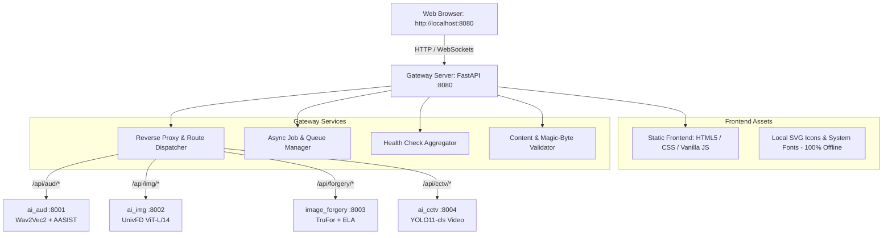

# Implementation Plan: Unified AI Forensics Platform

## 1. System Architecture



## 2. Directory Structure

```
bihar/
├── frontend/
│   ├── index.html           # Main SPA entry
│   ├── css/
│   │   ├── variables.css    # Warm Claude-like design tokens (Light/Dark)
│   │   ├── layout.css       # Responsive sidebar + centered thread layout
│   │   ├── components.css   # Cards, badges, buttons, waveform/gauge
│   │   └── modules.css      # Specialized views (Audio, Image, Forgery, CCTV)
│   ├── js/
│   │   ├── app.js           # App controller & router
│   │   ├── api.js           # Gateway API client
│   │   ├── state.js         # Reactive app state & IndexedDB history
│   │   ├── ui.js            # Thread & message renderer
│   │   ├── audio-view.js    # Waveform canvas & bona-fide logit display
│   │   ├── img-view.js      # Probability gauge & crop breakdown
│   │   ├── forgery-view.js  # TruFor overlay with opacity slider & ELA
│   │   └── cctv-view.js     # Video player + interactive canvas timeline
│   └── assets/
│       └── icons.svg        # Bundled offline SVG icon sprites
├── gateway/
│   ├── server.py            # Gateway server (FastAPI, reverse proxy, jobs)
│   ├── jobs.py              # Background job execution & progress store
│   ├── validator.py         # Magic bytes content validation
│   └── requirements.txt     # Minimal gateway deps (fastapi, uvicorn, httpx)
├── config/
│   └── modules.json         # Master manifest of all four forensic modules
├── scripts/
│   ├── launch.ps1           # Main launcher script (handles ports, venvs, run)
│   ├── stop.ps1             # Clean shutdown script (kills PIDs, removes runtime)
│   └── smoke_test.ps1       # Automated end-to-end API & module tester
├── docs/
│   ├── MODULES.md           # Deep inspection specs of all four modules (Done)
│   ├── CHANGES.md           # Changes log (Done)
│   └── PLAN.md              # Architecture and implementation plan
├── runtime/                 # ports.json, pids.json, active jobs (auto-created)
├── logs/                    # Service logs & launch logs (auto-created)
├── run.bat                  # Root launcher (calls scripts\launch.ps1)
├── stop.bat                 # Root stopper (calls scripts\stop.ps1)
└── README.md                # Complete documentation
```

## 3. Step-by-Step Implementation Strategy

1. **Config Manifest (`config/modules.json`)**:
   - Define exact entry apps, paths, python versions, model paths, default internal ports (8001-8004), supported file extensions, and forensic display metadata.

2. **Gateway Server (`gateway/`)**:
   - Built with lightweight FastAPI & `httpx` async client.
   - Proxies `/api/aud/*` to `ai_aud`, `/api/img/*` to `ai_img`, `/api/forgery/*` to `image_forgery`, and `/api/cctv/*` to `ai_cctv`.
   - Reverse proxies static artifacts dynamically so evidence images/plots render without CORS.
   - Provides `/api/health` checking all modules in parallel with timeout, returning up/starting/down status.
   - Provides `/api/jobs` and `/api/jobs/{id}` for asynchronous long operations (especially for CCTV and batch audio).
   - Enforces content inspection via file magic bytes (preventing extension spoofing).
   - Generates unique Request IDs and structured logs with SHA-256 hashes.

3. **Frontend Implementation (`frontend/`)**:
   - **Claude-inspired aesthetic**: Warm palette (`#FAF9F5` light, `#262624` dark, `#C96442` terracotta accent), serif headings, warm borders, glassmorphic cards.
   - **Sidebar**: Module status dots (live pinging `/api/health`), collapsible navigation, analysis history stored in IndexedDB, theme switch.
   - **Main Thread**: Chat/analysis stream. User bubble with file details, Assistant bubble with streaming status, progress bar, and forensic card.
   - **Four Custom Module Visualizers**:
     - *Audio*: Bona-fide logit display with explicit tooltip explaining it is not a percentage; canvas waveform with analyzed speech window highlighted.
     - *AI Image*: Calibrated P(fake) gauge, Real / Likely fake / Uncertain chip, quality gate notes, 9-crop score distribution.
     - *Forgery*: TruFor heatmap overlay with opacity slider (`0-100%`), side-by-side comparison toggle, ELA viewer, independent model scores.
     - *CCTV*: Live async progress bar, interactive Canvas/SVG frame score timeline linked to video player scrubber (clicking seeks video), flagged ranges, quality summary.
   - **Report Generation**: Export full JSON and generate print-friendly HTML forensic dossier with persistent caution notice: *"This is a forensic signal, not proof."*

4. **Launcher & Stopper Scripts (`scripts/`, `run.bat`, `stop.bat`)**:
   - Dynamic port finding starting from default ports.
   - Creates gateway `.venv` if not already present.
   - Background daemon launch of 4 backends + 1 gateway, storing PIDs.
   - Polling console health table until all services respond.
   - Launch browser pointing to gateway URL.
   - Clean shutdown with `stop.bat`.

5. **Validation & Automated Smoke Testing**:
   - Test each endpoint through `scripts/smoke_test.ps1`.
   - Verify all 4 sample inputs in the browser.
   - Verify dry-run mode, corrupt file rejection, and resilience when one module is stopped.
